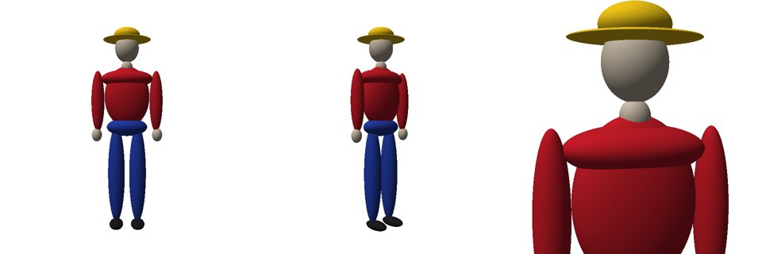
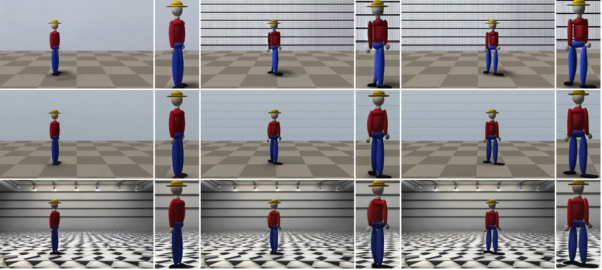
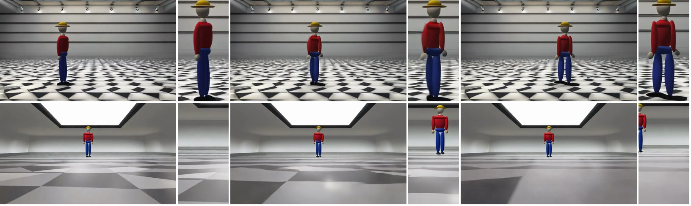

# Keeping a person's likeness in video, on mux (2026-11-17)

Thread's Studio Cast in Sets (proposal `docs/proposals/2026-11-17-studio-cast-in-sets.html` in Thread, §08 and §11 P3;
the owner said go on 2026-11-17) puts a real cast member, with recorded consent, on a Sets stand-in and makes the take
real. P3 asked mux for two things: pass Wan2.1-VACE's **reference images** and measure them against a first frame
alone; then **port one identity model** (Phantom 1.3B first, then Wan2.2-Animate's replace mode), with every licence
read from its files. Everything below was measured with a **synthetic subject**: a ray-traced mannequin with a yellow
hat, red jacket, blue trousers and black shoes, and no face (`tools/identity_scene.py`). No real person's picture was used,
and none should be used to test this.



## In short

- **VACE reference images work and cost little.** With depth control (Sets' take), first frame + 3 references holds
  the subject as well as the first frame alone and keeps the background closer to the first frame. References alone,
  with no first frame, rebuild the whole costume in a set VACE invents. They cost +47 % time (3 more latent frames) and no
  more memory. **For Sets, VACE + depth + references is the way**: the stand-in's place and motion come from the depth,
  its look from the references (and the first frame when there is one).
- **Phantom-Wan 1.3B is ported** (`video-subject`, its own server and kind). It was a small port, because Phantom's
  DiT is a stock Wan2.1-1.3B and diffusers runs it. On MPS it keeps the costume from the references alone, but it has
  **no layout control**: it puts its own figure where it likes (small, centred, standing). It is 2× VACE's time
  (three forwards a step).
- **Not answered here: a face.** The mannequin has none. Whether either model keeps a *person's* likeness, and not only
  a costume, needs a face. The next test is a non-photographic synthetic face (a stylised 3D character with distinct
  features), never a real person's photo, and should be run before Thread builds on either model.

## 1. Wan2.1-VACE reference images (`video`, `video-depth`: `reference_images_b64`)

The contract is in `docs/video.md`. Diffusers fits each reference to the frame on a white canvas, encodes it as one
latent frame ahead of the clip with a zero mask, and drops those frames from the output.

**The test** (2026-11-17, this Mac: M3 Ultra, 96 GB, PyTorch 2.14.1 MPS, diffusers 0.42.1; this branch's
`video_server.py` on a spare port, a fresh process each run): 2 s, 832×480, 16 fps, 20 steps, seed 11, the same
depth control (the mannequin walking 1.2 m across a studio, exact depth as 16-bit PNGs) and the same neutral prompt (*"a
stylised mannequin figure walks slowly across an empty studio with a chequered floor, soft daylight"*: no colours, so
the look must come from the pictures).

| Run | Time (load included) | Peak (process footprint) | Swap |
|---|---|---|---|
| (a) depth + first frame | 315 s | 31.1 GB | flat |
| (b) depth + first frame + 3 references | 463 s (+47 %) | 30.5 GB | flat |
| (c) depth + 3 references, no first frame | 464 s | 30.4 GB | flat |

How well the look holds, in the subject's mask (known from the render, eroded 2 px): the RGB histogram intersection
with the true render (8×8×8 bins; 1 = the same colours) and each part's mean-colour distance (RGB, 0–441):

| Run | 0 s | 1 s | 2 s |
|---|---|---|---|
| (a) first frame | 0.64 · hat 16, jacket 7, trousers 17 | 0.54 · 49, 26, 38 | 0.53 · 27, 26, 4 |
| (b) first frame + references | 0.65 · 36, 14, 11 | **0.60** · 66, 22, 25 | **0.60** · 80, 38, 27 |
| (c) references only | 0.38 · 74, 29, 31 | 0.52 · 86, 20, 36 | 0.50 · 92, 37, 35 |

Read the numbers with the pictures. The masks are the ideal render's, and the generated figure moves a few pixels off
them, so the small hat brim scores badly while it is plainly yellow in every frame. Frame 0 scores only 0.64 even where
it is given (the VAE's round trip moves colours across bins).



What the frames show:
- **(a)**: the subject holds (hat, jacket, trousers, shoes). The plain back wall turns into invented slatted blinds by
  1 s, which is VACE filling a featureless depth plane.
- **(b)**: the subject holds as well, the arms and hands follow the references' shapes, and the wall stays nearly plain:
  the best colour match at 1 and 2 s.
- **(c)**: with no first frame, VACE rebuilds the whole costume from the references (hat, red jacket, blue trousers,
  grey head, black shoes) in a set it invents (tiled floor, studio lights). The stand-in's walk comes from the depth.
  This is the case for a cast member on a stand-in when there is no made first frame.

## 2. Phantom-Wan 1.3B (`video-subject`)

| | |
|---|---|
| Model | **Phantom-Wan 1.3B**, Intelligent Creation Team, ByteDance (*Phantom: Subject-Consistent Video Generation via Cross-Modal Alignment*, arXiv:2502.11079) |
| Code | [`Phantom-video/Phantom`](https://github.com/Phantom-video/Phantom) at `bd84b602dcc949e23c89cbbf266b6f5975f2f025` (2025-09-11), sparse checkout in `~/.mux/phantom` (~290 MB); `LICENSE.txt` SHA-256 `bcaef9fc0ed41ec93bc7a81aa1f53ba0886a68baf0d62ef5d5d56682eaa9254e` |
| Weights | [`bytedance-research/Phantom`](https://huggingface.co/bytedance-research/Phantom) at `926cb19b8273d3841edcf905ca4ddb57f8e43207`, `Phantom-Wan-1.3B.pth` 5 692 970 224 bytes, SHA-256 `3a23db1c11e23d350d24a418dcd2a252f50193097bca838d0c4c3ea8be3c0a84` (the Hub's LFS record; checked on this Mac); a plain float32 state dict, 825 tensors, 1 418 996 800 parameters, read with `weights_only=True` |
| Text encoder, VAE | Wan2.1's umT5-XXL, tokenizer and VAE, the copies already in `~/.mux/models/wan2.1-vace-1.3b-diffusers` (Phantom's README takes them from `Wan-AI/Wan2.1-T2V-1.3B`; the same Wan2.1 files) |
| Runtime | `server/video/subject_server.py`, :8317, launchd `com.mux.video-subject` (`deploy/video-subject.sh`), the Wan server's venv; DiT bf16 (diffusers' float32 modules kept float32), VAE float32, T5 bf16 |
| Sampling | as upstream's `subject2video.py`: upstream's own `FlowUniPCMultistepScheduler` from the checkout, shift 5.0; guidance 5.0 (pictures) and 7.5 (text); Wan's negative prompt; **30 steps** (upstream: 50; `steps` 10–50 per request, `MUX_SUBJECT_STEPS`) |

### The port: why it was small

Phantom's `phantom_wan/modules/model.py` is Wan2.1's DiT. Diffed against `Wan-Video/Wan2.1`'s, it differs only in the
flf2v additions Wan made later and in Wan's float64 RoPE. `configs/wan_s2v_1_3B.py` is Wan2.1-T2V-1.3B's shape. So
instead of importing upstream's model, which uses CUDA devices, `torch.cuda.amp`, flash-attn, xfuser and FSDP:
- the checkpoint is converted by **diffusers' own `convert_wan_transformer_to_diffusers`** into a
  `WanTransformer3DModel`, and every tensor fits (none missing, none extra);
- the text encoder, tokenizer and VAE are diffusers' Wan2.1 ones, which run on MPS in the Wan server today (with its
  conv3d fix: `docs/video.md`);
- upstream's `Phantom_Wan_S2V.generate` (~40 lines) is written again on those parts. Each reference is letterboxed on
  white (upstream's `load_ref_images`, tested pixel-equal) and VAE-encoded to one latent frame. The references go after
  the clip's latent frames and are put back clean before each step's three forwards (text + pictures, pictures alone,
  neither with zeros for the pictures). The mix is `neg + 5.0·(pos_i − neg) + 7.5·(pos_it − pos_i)`. The references are
  dropped before decoding;
- the scheduler is upstream's own file, imported from the checkout. Diffusers' UniPC with `flow_shift` is close but not
  equal (timesteps up to 4 apart, a 0.7 % drift over 30 toy steps).

Nothing in mux is copied from Phantom. The job API, queue, GPU lock, AI label and mp4 are the Wan server's.

### Proven and not proven

| | Status | Evidence |
|---|---|---|
| The checkpoint fits Wan2.1-1.3B in diffusers | **Proven** (real weights) | 825/825 tensors, 1 418 996 800 parameters, loaded in 6 s on the CPU |
| References prepared as upstream | **Proven** | `test_subject_server.py`: pixel-equal to upstream's `load_ref_images` (tall, wide, exact, square) |
| The sampler's mechanics | **Proven** with stand-ins | three forwards a step with the right contexts, references clean at the end of every forward, zeros in the third, bf16 in, references dropped before decoding, 10 steps reported |
| Upstream's scheduler | **Proven** imported | from the checkout, 30 steps at shift 5 |
| Job API, validation, the label | **Proven** with a stub model | 1–4 references, no `image_b64`/`control`, 1–5 s, steps 10–50; `label_burned` |
| The gateway | **Proven** | `server/test/video.test.ts`: `video-subject` is its own kind; plain `video` with references goes to Wan; 400 without references |
| **The real model on MPS, 2 s** | **Proven** (pictures right) | 653 s for 2 s at 832×480, 16 fps, 30 steps (load 32 s), **peak 29.9 GB**, swap flat |
| Numeric parity with upstream's CUDA output | **Not proven** | no CUDA here; the parts are each upstream's or tested equal |
| 50 steps, 1280×720, 5 s | **Not proven** | not run (expected ~1.7× the time at 50 steps) |
| A face | **Not tested** | the synthetic subject has none |



**What it made:** a clean, coherent clip of the mannequin in a bright studio it invented. The costume is right
everywhere: yellow hat, red jacket, blue trousers, grey head, black shoes, from the three references and a prompt with
no colours. It is small and centred and stands nearly still. The prompt's walk barely shows, and there is no depth or
first frame to place it, so the mask-based scores do not apply (0.04–0.20; the figure is not where the mask is).

## 3. The candidates

Licences read from the files on 2026-11-17 (a reading, not legal advice). Under the owner's rule (we are not
commercial, we are research, our location is the world), none is ruled out by its licence. Attribution and share-alike
terms are kept.

| | Licence (from the files) | Size | On this Mac | Verdict |
|---|---|---|---|---|
| **Wan2.1-VACE 1.3B** + references | Apache-2.0 (`LICENSE.txt` in the weights repo; `docs/video.md`) | 19 GB (on the Mac) | **measured**: 2 s in 315–464 s, 31 GB | **use for Sets**: depth keeps the stand-in's place and motion, references the look |
| **Phantom-Wan 1.3B** | **Apache-2.0**: code `LICENSE.txt` (Apache License 2.0, SHA-256 above), weights card `license: apache-2.0`. Keep the notice; say what changed (§4). `deploy/video-subject.sh` puts `LICENSE.txt` and a `NOTICE` crediting ByteDance beside the weights | 5.7 GB + Wan2.1's T5/VAE | **ported, measured**: 2 s in 653 s, 29.9 GB | research: the look without layout control. Useful where there is no Sets geometry |
| **Stand-In** (WeChatCV) | **Apache-2.0**: [`WeChatCV/Stand-In`](https://github.com/WeChatCV/Stand-In) at `e351224366be169076e94af1454115d91d458313`, `LICENSE` (the standard Apache-2.0 text, the same git blob as Wan2.2's); weights [`BowenXue/Stand-In`](https://huggingface.co/BowenXue/Stand-In) at `c6e9017606276ee1a01c63fdb8f90da789678647`, card `apache-2.0`. Needs **antelopev2** from InsightFace, whose models are *"available for non-commercial research purposes only"* (insightface README): allowed for us, research | 153M-parameter plug-in (0.63 GB per base) on **Wan2.1-T2V-14B** or Wan2.2-T2V-A14B only; no 1.3B | 14B on MPS: ~28 GB of weights in bf16 + 11 GB T5; ~10× the 1.3B's compute, so a 2 s clip in roughly an hour or more (estimate). flash-attn optional | the face-specific one (best face similarity in its paper). The next port if a face test shows VACE/Phantom lose the face; 14B cost |
| **Wan2.2-Animate-14B** (replace mode) | **Apache-2.0**: [`Wan-Video/Wan2.2`](https://github.com/Wan-Video/Wan2.2) at `1ea34ff48f87168174e12956e200b1d908b1c5ff`, `LICENSE.txt` (Apache-2.0); weights [`Wan-AI/Wan2.2-Animate-14B`](https://huggingface.co/Wan-AI/Wan2.2-Animate-14B) at `cb93a225fbaf1ca100f54e79da8f994995b689b3`, card `apache-2.0` | 72 GB repo | in **diffusers** since Nov 2025 (`Wan-AI/Wan2.2-Animate-14B-Diffusers`), so no CUDA code to port; but 14B, and replace mode needs upstream's preprocessing (pose, face crops, SAM2 masks: `wan/modules/animate/preprocess`); README: an 80 GB GPU | the right model for "this person in place of the stand-in in a given video", but a large port: preprocessing on MPS, 14B memory. Plan it after the face test |
| **PuLID-FLUX** (stills) | Code **Apache-2.0** ([`ToTheBeginning/PuLID`](https://github.com/ToTheBeginning/PuLID) at `1aa2fc7df4bf51080df39f355f9abdc1cbfefbaa`, `LICENSE` the standard text); weights [`guozinan/PuLID`](https://huggingface.co/guozinan/PuLID) at `492b1451255dc9d9bc3c857259690b5f8b998d4a`, card `apache-2.0`. Runs on **FLUX.1 [dev]** (FLUX.1 [dev] Non-Commercial License: allowed, research; `docs/backdrop.md`) and InsightFace's antelopev2 (non-commercial research only) | 4.9 GB + FLUX.1-dev | stills, not video: a first frame for VACE. FLUX.1-dev is not on the Mac yet (`docs/backdrop.md` waits on it) | a way to make a likeness-true **first frame**, which VACE (a)/(b) then holds |
| **HunyuanCustom** | **Tencent Hunyuan Community License** ([`Tencent-Hunyuan/HunyuanCustom`](https://github.com/Tencent-Hunyuan/HunyuanCustom) at `4d84cfe9cec99afa739d82b5c6b5026b9406ffe8`, `LICENSE` SHA-256 `1090b40d6b1aa6db3fdadd4c75a59da9f43e70a38ac4e95d8088a175d342f773`): *"does not apply in the European Union, United Kingdom and South Korea"* (Territory excludes them: accepted under the owner's rule); over 100 million MAU needs Tencent's licence; *"must not use … any Output … to improve any other AI model"*; Tencent's marks only as customary; *"Tencent claims no rights in Outputs"*; weights [`tencent/HunyuanCustom`](https://huggingface.co/tencent/HunyuanCustom) at `75bd4142171112ad4ec363374df4181e8f341e15` | 191 GB repo (13B HunyuanVideo base) | far beyond a 1.3B: an 80 GB-class GPU in its README; not a sensible MPS port now | not now |

## Running it

```sh
cd ~/_code/mux/mux && git pull --ff-only && npm run build && launchctl kickstart -k gui/$(id -u)/com.mux.server
launchctl kickstart -k gui/$(id -u)/com.mux.video          # reference_images_b64, the label, the conv3d fix
./deploy/video-subject.sh                                   # Phantom: code, weights (pinned), tests, :8317, a 2 s clip
```

No tenant is given `video-subject`: the owner decides. Thread reaches VACE's references through `video-depth` as it
is. The measurement tools: `tools/identity_scene.py` (the synthetic subject and its depth) and `tools/identity_look.py`
(the frames and the numbers).
