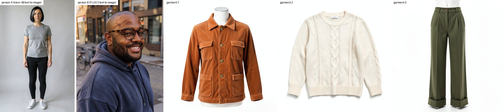
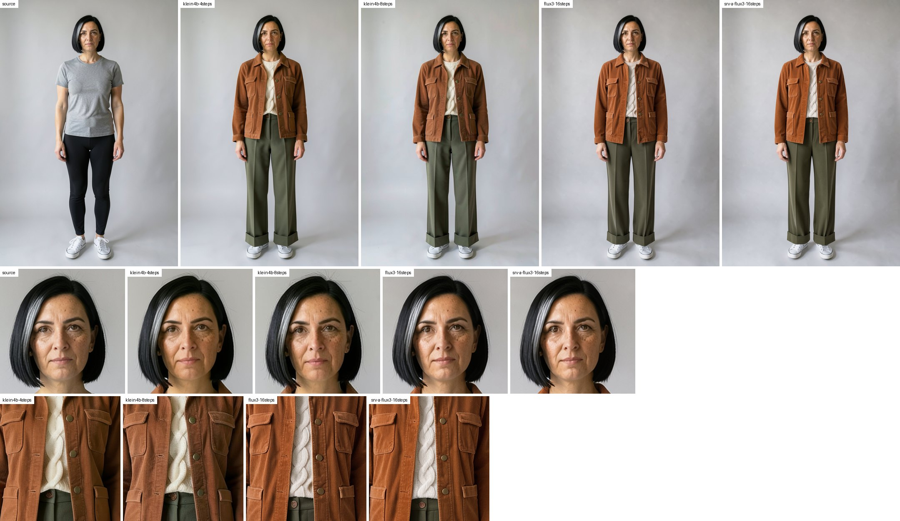
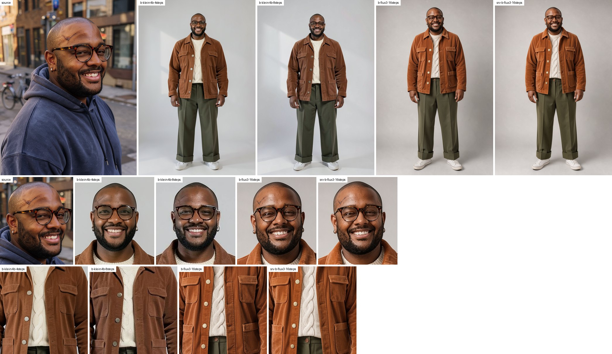

# Identity edits on mux: `image-edit-hq` (2026-11-17)

Thread's **Fashion try-on** sends a person's photo and clothing photos to mux's `image-edit`, and the result did not
look like the person. `image-edit` is FLUX.2 [klein] 4B Q4 at 4 steps: fast, and weak at carrying a person across
several references. The owner's bar: **"more real than real"**. This page surveys the open models that could do
better on this Mac (M3 Ultra, 96 GB, MLX), picks one, serves it as a second edit model on the route **`image-edit-hq`**,
and measures it against klein with synthetic people only.

**In short:** **FLUX 3 Image Klein** (Black Forest Labs, Nov 2026, 5.6B, FLUX Kommunity License v1.0), 8-bit through
mflux, is now a second model of the image server (`flux3-image-klein-q8`, route `image-edit-hq`). On the hard case (a
casual three-quarter phone photo of a person into a full-length studio try-on) it **keeps the person and klein does
not**: klein gives a slimmer, more generic face, other glasses and an earring in each ear; FLUX 3 keeps the round face,
the forehead scar, the round tortoiseshell glasses, the single hoop, the stocky build and the skin tone. The garments'
colours and fabrics are closer too, and the skin and light look more natural. On the easy case (a front-facing studio
photo that klein made itself) the two are close. It costs **~2.5 min a try-on** (16 steps; klein 4B: 34–100 s) and
**14–15 GB peak** (klein: 9–11 GB). klein stays the fast default for everything else.

## 1. The survey

Licences read from the files on 2026-11-17 (a reading, not legal advice). Under the owner's rule (we are not commercial,
we are research, our location is the world) none is ruled out by its licence; attribution and notices are kept.
Sizes and revisions from the Hugging Face API. "Peak" is the process's footprint on this Mac where measured.

| Model | Licence (from the files) | Size, quantisation | Memory | MLX / MPS | Speed (try-on: 1 person + 3 garments, 832×1248) | References |
|---|---|---|---|---|---|---|
| **FLUX.2 [klein] 4B** (now `image-edit`) | Apache-2.0 | 4.6 GB, Q4 (`mflux-community/flux2-klein-4b-mflux-q4`) | **measured 10.5 GB** (garments 0.26 MP: 8.8 GB) | mflux 0.24 | **measured** 4 steps 73–99 s, 8 steps 138–227 s; garments at 0.26 MP: 34 s | many (server keeps 10) |
| **FLUX 3 Image Klein** (picked) | **FLUX Kommunity License v1.0** (`LICENSE.md` of `black-forest-labs/flux-3-image-klein` @ `09561231`, SHA-256 `100a3a5a…1f22`); text encoder Qwen3-VL-4B-Instruct Apache-2.0 | 9.9 GB, Q8 (`mflux-community/flux-3-image-klein-mflux-q8` @ `7e46237d`); bf16 18.5 GB | **measured 14–15 GB** | mflux 0.24 (`Flux3KleinEdit`) | **measured** 16 steps 148–169 s (garments 0.26 MP), 363–650 s (garments 1 MP) | up to 10; bounding boxes |
| FLUX.2 [klein] 9B | **FLUX Non-Commercial License v2.1** (`LICENSE.md` @ `92196c8e`, SHA-256 `468d9f43…7d3b`, the same file as FLUX.2 [dev]'s) | 17.9 GB Q8 / 9.5 GB Q4 (mflux-community); 9B + Qwen3-8B encoder | ~20–25 GB Q8 (estimate) | mflux 0.24 (`flux2-klein-9b`) | ~2× klein 4B per step, 4 steps (estimate) | many |
| FLUX.2 [dev] | FLUX Non-Commercial License v2.1 (same file) | 177.6 GB repo; 32B transformer + Mistral-Small-3.1 24B encoder | ≥ 60 GB even at 4 bits with the encoder (estimate) | **not in mflux 0.24**; diffusers MPS bf16 needs ~110 GB | minutes per step (estimate) | up to 10 |
| Qwen-Image-Edit-2509 | **Apache-2.0** (card `license: apache-2.0`; the weights repo has no LICENSE file; `QwenLM/Qwen-Image` `LICENSE` @ `6b5e1f5c` is the Apache License 2.0, "Copyright 2024 Alibaba Cloud", SHA-256 `b907c823…5d08`) | 29.0 GB Q4 / 37.5 GB Q8 (mflux-community); 20B MMDiT + Qwen2.5-VL-7B | ~35–45 GB Q4 (estimate) | mflux 0.24 (`qwen-image-edit`) | 40 steps with true CFG (2 passes a step) on 20B: ~10–20 min (estimate) | 1–3 best |
| Qwen-Image-Edit-2511 | Apache-2.0 (as 2509; card says *"improved character consistency"*) | as 2509 | as 2509 | mflux 0.24 (`qwen-image-edit-2511`) | as 2509 | 1–3 best |
| Qwen-Image-2.1 (edit) | **Qwen Research License** (`LICENSE` @ `d26bb612`, SHA-256 `8dc973f0…b28d`): research or evaluation only; give recipients the licence; a NOTICE line *"Qwen is licensed under the Qwen RESEARCH LICENSE AGREEMENT, Copyright (c) 2026 Hangzhou Tongyi Laboratory Technology Co., Ltd. All Rights Reserved."*; "Built with Qwen" if outputs train a model; Chinese law | **33.1 GB** (bf16; no pre-quantised MLX copy; Turbo 32.5 GB); 7.1B + Qwen3-VL encoder 17.5 GB | bf16 ~46 GB (mflux README), Q8 less | mflux 0.24 (`QwenImage21Edit`) | 40 steps (Turbo 8) | up to 10; mflux shows a two-reference clothing edit |

Seen and not evaluated: Bria's FIBO 2.0 edit (JSON-structured prompts, not identity work), Krea 2, Z-Image, ERNIE-Image
(text to image only in mflux).

## 2. The choice, and why

- **FLUX 3 Image Klein** is the newest (2026-11-02), built for editing ("the checkpoint behind the BFL API"), takes up
  to 10 references through a vision-language encoder, is in mflux 0.24 (the server's own engine and version), and its
  8-bit copy is 9.9 GB on disk and ~15 GB in memory: it fits beside a resident chat model with room to spare.
- **Qwen-Image-2.1** is the other 2026 candidate (7B, 10 references, a try-on example in mflux), but it is 33.1 GB to
  download with no smaller copy: with 44 GB free that leaves 11 GB, under the 15 GB rule. **To try it, the Mac needs
  ≥ 48 GB free** (≥ 65 GB to also save an 8-bit copy of ~17 GB beside the download, then delete the original).
- **Qwen-Image-Edit-2511** (Apache-2.0, "better character consistency") Q4 is 29 GB: exactly the 15 GB margin with
  today's disk, a 20B model at 4 bits, and 40 steps with CFG: likely 10+ minutes a try-on. Not tried.
- **FLUX.2 klein 9B** would be a step up from 4B, but the same generation as the model that fails; FLUX 3 is the
  newer design. **FLUX.2 [dev]** does not fit the 40 GB peak.

## 3. How it is served

One server, two models, one in memory at a time: `server/images/image_server.py` (launchd `com.mux.images`, :8312).

- `MUX_IMAGE_HQ_MODEL=flux3-image-klein-q8`, `MUX_IMAGE_HQ_BASE_MODEL=flux3-image-klein`,
  `MUX_IMAGE_HQ_MODEL_PATH=~/.mux/models/flux-3-image-klein-mflux-q8`, `MUX_IMAGE_HQ_STEPS=16` (set by
  `deploy/images.sh` whenever those weights are on disk; `deploy/image-edit-hq.sh` fetches them).
- A request whose `model` is `flux3-image-klein-q8`, `image-edit-hq` or `image-hq` gets FLUX 3; every other request
  gets klein, as before. Asking for the other model lets the first go (and empties MLX's cache) before it loads: never
  two in memory. The same lock, one MLX thread, 2 GB cache cap and 10-minute idle let-go.
- **Garments are made smaller:** for FLUX 3, every image after the first is resized to at most 0.26 MP (512×512)
  before encoding (`MUX_IMAGE_HQ_REF_MP`). Each reference is tokens the transformer attends over at every step; three
  1024² garments made a try-on 4× slower (310 s against 77 s, 8 steps) with the same look (the identity, the scar, the
  cable knit, the corduroy all held). The first image (the person) is kept as it came.
- Memory: loading FLUX 3 needs 24 GB free (`MUX_IMAGE_HQ_MIN_FREE_GB`; the measured peak is 15 GB, the rest is margin),
  else a 503 that says why; `/v1/models` lists both models with `loaded`, and FLUX 3's `need_gb` while it is not
  loaded, so mux's `roomForService` lets idle chat models go first.
- mflux keeps every prompt's text embeddings for the life of a pipeline (`prompt_cache`): memory that grows and prompts
  kept after their request. Now dropped after every request, for klein too.
- mux: model `flux3-image-klein-q8` (external, `size_bytes` 16 GB), route **`image-edit-hq`** = `flux3-image-klein-q8`
  then `flux2-klein-4b-q4` (if FLUX 3 fails or the Mac is short of memory, the fast model answers). The gateway needed
  no code change (`server/test/images.test.ts` proves the route and the fall-through).
- The AI label is untouched: mux returns the image; Thread labels it, as for `image-edit`.

### What Thread sends

The same OpenAI multipart edit as today, with the route's name:

```
POST $MUX_BASE_URL/v1/images/edits         (Authorization: Bearer $MUX_API_KEY)
  model=image-edit-hq
  prompt=<a full caption of the result, see below>
  image[]=<the person>                     first: the picture whose shape the result takes
  image[]=<garment 1> image[]=<garment 2> …  up to 9 more
  size=832x1248 | auto                     optional; auto = the first image's shape at ~1 MP; each side ≤ 2048, multiple of 16
  seed=<int>                               optional
  steps=16                                 optional, 1–50; 8 looked the same in these tests and is ~half the time
  n=1                                      each extra image costs the whole time again
→ {"created", "model": "flux3-image-klein-q8", "data": [{"b64_json"}]}
```

Thread can switch every edit over with `THREAD_MUX_EDIT_MODEL=image-edit-hq` (Thread's `server/providers/mux.mjs`), but
that would make every image-edit node ~3 min; better to send `model: image-edit-hq` only from Fashion try-on. Allow
≥ 5 minutes before timing out (a cold load and a busy Mac). **Prompts:** FLUX 3 is trained on full captions of the
*result* (BFL runs an 18.8 GB prompt upsampler in front of it, not ported). A one-line instruction reframes the shot.
Write what the picture shows: who (the person from image 1, with their distinctive features named), what they wear
(each garment from image N, with the spec), the setting, the light, the lens. The two prompts used here are
`docs/identity/tryon-prompt-a.txt` and `tryon-prompt-b.txt`. Thread's chat model could write them from the garment spec.

## 4. The measurements

**Setup** (2026-11-17, this Mac: M3 Ultra, 96 GB, mflux 0.24.0, MLX 0.32.4; this branch's server on spare port :8322, a
fresh process per run; the chat model qwen3.6-35b-a3b resident in llama-server, ~25 GB, and serving): a try-on edit,
person + 3 garments + a garment-spec caption, output 832×1248, seed 11. Peak is the process's lifetime maximum
footprint (MLX's buffers included, load included). Swap stayed at 3.7 GB throughout. Tool: `tools/tryon_measure.py`.

**The synthetic inputs** (no real person; `docs/identity/tryon-inputs.jpg`): person A, a fictional woman, front-facing
studio photo made by **klein 4B** with the existing `image` route; person B, a fictional man, a casual waist-up phone
photo, three-quarter view, outdoors, made by **FLUX 3**; three garments (rust-orange corduroy chore jacket, cream
cable-knit sweater, olive wide-leg trousers) made by klein. Each model gets one person it made itself, so neither gets
only home games.



| Run | Steps | Garments | Time (load included) | Peak |
|---|---|---|---|---|
| A · klein 4B Q4 | 4 | 1024² | 73.5 s | 10.5 GB |
| A · klein 4B Q4 | 8 | 1024² | 138.1 s | 10.5 GB |
| A · FLUX 3 Q8 | 16 | 1024² | 363.0 s | 15.3 GB |
| A · FLUX 3 Q8 (served) | 16 | 0.26 MP (server) | 169.2 s | 14.1 GB |
| A · FLUX 3 Q8 (served) | 8 | 0.26 MP (server) | 154.0 s | 14.0 GB |
| B · klein 4B Q4 | 4 | 1024² | 98.9 s | 10.5 GB |
| B · klein 4B Q4 | 8 | 1024² | 226.7 s | 10.6 GB |
| B · klein 4B Q4 | 4 | 512² | 33.8 s | 8.8 GB |
| B · FLUX 3 Q8 | 16 | 1024² | 649.6 s | 15.3 GB |
| B · FLUX 3 Q8 | 8 | 1024² | 309.6 s | 15.3 GB |
| B · FLUX 3 Q8 | 8 | 512² | 77.4 s | 13.9 GB |
| B · FLUX 3 Q8 (served) | 16 | 0.26 MP (server) | 147.7 s | 14.1 GB |

FLUX 3 loads in 7 s, klein in 1 s (warm disk cache). **The times are noisy**: the same work ran up to 2× slower when the
chat model was busy (klein's 4 steps: 73 s on A, 99 s on B, the same token count), and an 8-step run once took as long
as a 16-step one. Read them as ranges. Memory is steady.

### Person A (front-facing, studio; made by klein)



- **Face and body:** all four keep her: the bob with the silver streak, the freckles, the brows, the slim build with
  broad shoulders. klein grades her skin darker and more orange than the source and over-sharpens it (crunchy pores,
  deeper lines: she looks older). FLUX 3 keeps the source's skin tone and softness.
- **Garments:** all right in kind. FLUX 3 matches the jacket's rust-orange; klein's is browner. The cable knit is
  cleaner in FLUX 3; corduroy wales are good in both. No model made the buttons brass as asked (klein bronze, FLUX 3
  bronze-cream).
- **How real:** klein's look is a little "AI-sharp"; FLUX 3's light and skin read as a photograph.

### Person B (three-quarter phone photo outdoors → full-length studio; made by FLUX 3)



- **klein loses him.** It makes a slimmer man with a narrower, more generic face, rectangular-ish frames, an earring in
  **both** ears, a fainter scar, and a lighter build than the stocky source. Recognisably "a man with glasses and a
  beard", not this man. 8 steps does not help.
- **FLUX 3 keeps him:** the round face and cheeks, the scar's shape on the forehead, the round tortoiseshell glasses,
  the single hoop, the beard line, the skin tone, the broad stocky body. It also turns the face to camera as the prompt
  asks, which is the hard part of a try-on from a casual photo.
- **Garments:** FLUX 3's jacket colour, pockets and cable knit match the references; buttons cream, not brass.
  klein's jacket is browner, buttons silver.
- **How real:** FLUX 3's studio light, fabric pile and skin read as a photograph; klein's has a hard sheen.
- Shrinking the garments to 0.26 MP changed nothing visible (`b-flux3-8steps` vs the 512² run) and 8 vs 16 steps
  changed little.

## 5. Proven and not proven

| | Status | Evidence |
|---|---|---|
| FLUX 3 Image Klein Q8 runs on this Mac through mflux 0.24 | **Proven** | 7 try-on edits and a text-to-image, no error |
| Pinned weights | **Proven** | SHA-256 of all 7 weight files equal the Hub's LFS records at `7e46237d` (checked on this Mac) |
| Peak memory ≤ ~40 GB with a chat model resident | **Proven** | 14–15 GB peak, swap flat, beside qwen3.6-35b-a3b |
| Keeps a person's identity better than klein 4B on a hard try-on | **Proven on one synthetic person** | person B, above |
| As good as klein on an easy try-on | **Proven on one synthetic person** | person A, above |
| More real (skin, fabric, light) | **Seen**, my judgement | both people |
| Garments at 0.26 MP keep the look and cut the time ~4× | **Proven on person B** (FLUX 3, 8 steps) | 77 s vs 310 s |
| 8 steps as good as 16 | **Seen on person B**; A at 8 steps looked the same | default stays BFL's 16 |
| Server: routing by name, one model in memory, shrink, memory refusal, prompts dropped | **Proven** without weights | `server/images/test_image_edit_hq.py` |
| Gateway route `image-edit-hq` and fall-through to klein | **Proven** | `server/test/images.test.ts` |
| Real people's photos | **Not tested**, on purpose | synthetic people only |
| Many people, many garments, side and back views, 2048² output | **Not tested** | one person each, 832×1248 |
| Run through `com.mux.images` and Railway | **Not run** | the service was not restarted; the owner's command below |
| Qwen-Image-2.1, Qwen-Image-Edit-2511, klein 9B | **Not tested** | disk (§2) |

## 6. Licence: FLUX 3 Image Klein (FLUX Kommunity License v1.0)

Read from `LICENSE.md` of `black-forest-labs/flux-3-image-klein` at `09561231f44e41381c461caf53d5452005a60ac9`
(SHA-256 `100a3a5af8f1a2943dca0d127671bcaa93ad894a63330825219f1a0a44451f22`; `deploy/image-edit-hq.sh` checks it):

- Grant: non-commercial use (research, testing, personal; *"use … in direct interactions with or that has impact on
  end users"* is not a non-commercial purpose), and for a **Qualifying User** (< US$5M gross annualised revenue with
  affiliates) commercial use of **outputs**, with the model used in production only to make them. We are research; if
  Thread charges for try-ons, raise it with the owner first (CLAUDE.md), though the Qualifying-User clause may cover it.
- Outputs: BFL claims no rights. Conditions: content filtering **or** review for unlawful content, and an AI disclosure
  where the law requires one (Thread's prompt checks and its AI label; never remove them).
- Restrictions (§4): no military or surveillance use, **no biometric processing**, nothing that violates rights of
  publicity or "digital replica" rights, no non-consensual intimate images, no use of outputs to improve another
  image model. Try-on of a person needs that person's consent (Thread records it); mux does no face recognition or
  embedding.
- Distribution of the weights or derivatives: give the licence and the attribution notice. mux does not distribute
  them; `deploy/image-edit-hq.sh` still puts `LICENSE.md` and a `NOTICE` (the notice text, crediting Black Forest Labs
  and mflux-community's conversion) beside the weights.
- Trademarks: "FLUX" and "Black Forest Labs" only to describe the model.
- The text encoder is Qwen3-VL-4B-Instruct, Apache-2.0 per BFL's card (its own `text_encoder/LICENSE` could not be fetched here; not read).

FLUX Non-Commercial License v2.1 (FLUX.2 [klein] 9B and [dev]): non-commercial only, with the same restrictions and
content-filter and disclosure conditions; outputs may be used for any purpose except to train a competing model.

## Running it

```sh
cd ~/_code/mux/mux && git pull --ff-only          # once image-edit-real is merged
./deploy/image-edit-hq.sh            # weights (9.9 GB, pinned, SHA-256), licence, images.sh --q4 --keep, a test edit
./deploy/image-edit-hq.sh --railway  # then: route image-edit-hq on Railway mux, allowed for thread
```

Earlier, unused: `server/images/flux3_server.py` and `deploy/flux3.sh` (docs/FLUX3-MAC.md) planned FLUX 3 as its own
server on :8314, which is now the measure server's port; never installed. `image-edit-hq` replaces that plan.
